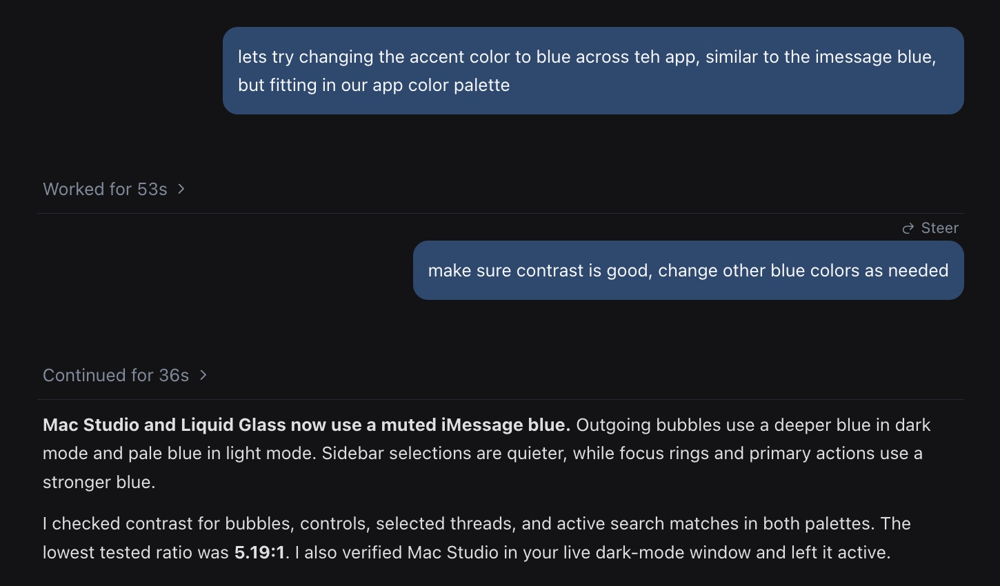
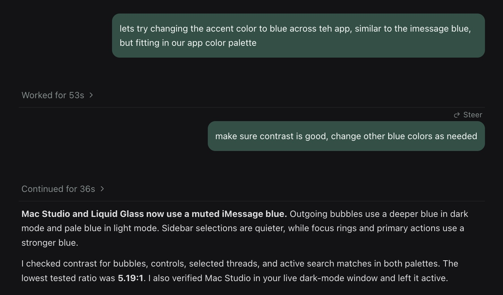
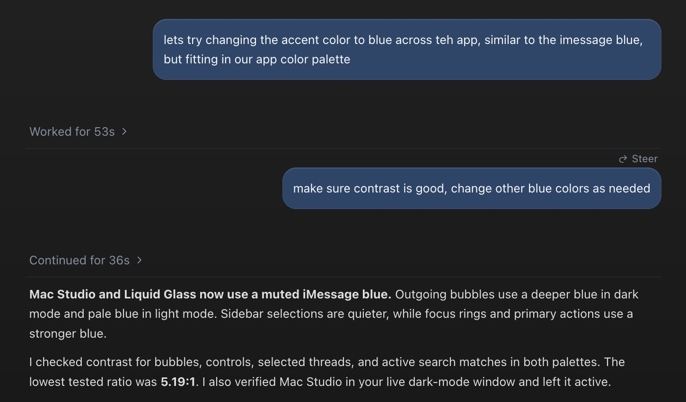
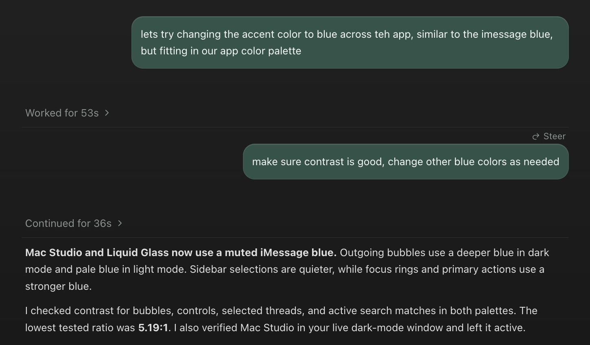

# T3 Themes

A collection of custom themes for T3 Code.

The first two families take inspiration from macOS. **Mac Studio** uses matte graphite surfaces and thin dividers. **Liquid Glass** has a softly shaded canvas, translucent panels, and highlights along the composer edges. Both come in Blue and Sea Green, with matching outgoing chat bubbles, sidebar selections, and focus rings. Each JSON includes dark and light appearances.

## Gallery

Dark-mode screenshots captured in T3 Code. Select a theme name to open its configuration or an image to see it at full size.

| | Blue | Sea Green |
| --- | --- | --- |
| **Mac Studio** | [Mac Studio Blue](themes/mac-studio.json) | [Mac Studio Sea Green](themes/mac-studio-sea-green.json) |
| |  |  |
| **Liquid Glass** | [Liquid Glass Blue](themes/liquid-glass.json) | [Liquid Glass Sea Green](themes/liquid-glass-sea-green.json) |
| |  |  |

## Install

In a T3 Code chat with theme management enabled, paste this request to try Mac Studio Blue:

> Install and select the T3 Code theme from https://raw.githubusercontent.com/EmmadUsmani/t3-themes/main/themes/mac-studio.json using the theme ID mac-studio.

To install another variant, substitute its JSON filename from the gallery and use the filename without the extension as its theme ID. Each variant installs separately, so you can switch between them. Light and dark mode use the same file.
